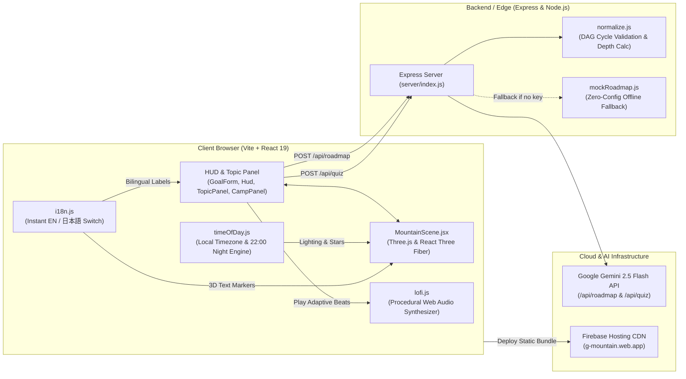

<div align="center">

# 🏔️ AI Knowledge Mountain (G-Mountain)

<p align="center">
  <b>Don't just show students what they need to learn. Show them how far they've climbed.</b><br/>
  「何を学ぶか」だけでなく、「どれだけ登ってきたか」を可視化する3D学習アドベンチャー
</p>

[](https://react.dev/)
[](https://threejs.org/)
[](https://docs.pmnd.rs/react-three-fiber/)
[](https://vitejs.dev/)
[](https://nodejs.org/)
[](https://expressjs.com/)
[](https://aistudio.google.com/)
[](https://firebase.google.com/)
[](https://developer.mozilla.org/en-US/docs/Web/API/Web_Audio_API)

<br/>

🌐 **Live Demo:** [https://g-mountain.web.app](https://g-mountain.web.app) &nbsp;|&nbsp; 
🌐 **Repository:** [github.com/sodhuumendsanaa-oss/G-Mountain](https://github.com/sodhuumendsanaa-oss/G-Mountain)

</div>

---

## 💡 1. The Problem & Solution / 開発の背景と解決策

### ❌ The Problem / 独学者が直面する見えない壁
* **Where to start?**: Big learning goals (e.g., Artificial Intelligence, Web Development) overwhelm self-directed learners.
* **Invisible progress**: Traditional platforms use flat checklists or progress bars (`35% completed`). Imagine studying ML for 6 months—how do you visually demonstrate that journey to a mentor, teacher, or employer?
* **Burnout & demotivation**: When concepts become steep and tests get difficult, learners lose momentum with no structured resting milestones.

### 🌟 The Solution: Transform Learning into a 3D Mountain Climb
Instead of a boring spreadsheet or flowchart, **AI Knowledge Mountain** converts a student's personal learning journey into an **interactive, procedural 3D mountain**:
* **Base Camp (0 m)**: Foundational prerequisites sit in lush green alpine valleys.
* **Slopes & Ridges**: Intermediate and advanced concepts wind upward along steep mountain ridges.
* **Summit Flag (8,848 m)**: A capstone project waits at the snowy peak with sparkling celebration fireworks.
* **Climbing Avatar & Dual Pace**: Your climber moves physically up the mountain as you complete topics, competing against a ghost **"Pace"** climber that simulates your timeline.

---

## 🏗️ 2. System Architecture & Flowchart / システム構成図

### 🔄 Student Journey Flowchart (学習フロー)

```mermaid
flowchart TD
    A[🎯 Step 1: Set Learning Goal<br/>Goal, Timeline, Level, Hours/Day] --> B[🤖 Step 2: AI Curriculum Analysis<br/>Gemini 2.5 Flash DAG Engine]
    B --> C[⛰️ Step 3: 3D Mountain Generation<br/>Spiral Trail, Slope Biomes, Altitude Mapping]
    C --> D[⏱️ Step 4: Countdown & Dual Climbers<br/>Avatar 'You' vs Ghost 'Pace']
    
    D --> E{🧗 Pick Next Available Node}
    E --> F[🧠 AI Checkpoint Test<br/>Difficulty 1-5 Assessment]
    
    F -->|Pass / Struggle| G{🤖 AI Rest Decision}
    G -->|Test Diff >= 4 OR Long Push| H[⛺ Pitch Camp & Light Campfire<br/>Timer Pauses + Rest Advice + Review]
    G -->|Clear & Fresh| I[⛏️ Mark as Learned<br/>Gold Trail & Next Topics Unlocked]
    
    H -->|Recharged & Ready| I
    I --> J{Summit Reached?}
    J -->|Not Yet| E
    J -->|All Topics Done| K[🏆 Summit Flag Sparkles (8,848m)<br/>Conquered with Days to Spare!]
```

---

### 🏛️ Technical Architecture (技術アーキテクチャ)



---

## ⚡ 3. Key Features / 主要機能

| Feature | Description | 技術ハイライト |
|:---|:---|:---|
| **🏔️ 3D Alpine Terrain** | Procedural heightfield, ridged multifractal crests, elevation & slope-aware biome texturing (meadows → pine forests → dark rock → snowline), scattered boulders, drifting clouds, and summit snow particles. | `@react-three/fiber`, Three.js custom BufferGeometry |
| **🤖 AI Difficulty-Driven Rest Stops** | Gemini assesses test hardness (`⚡ 1..5/5`). For grueling exams (`>= 4/5`), AI pitches **Camp I, II, III**, ignites a flickering campfire (`🔥`), and automatically **pauses the countdown timer** so learners can recover. | Gemini Structured Schema, dynamic graph nodes |
| **🌙 Local Timezone Sky & 22:00 Night Climb** | Detects local timezone clock. At **22:00 Night**, the sky transforms with **2,600 twinkling stars**, a glowing full moon, boosted campfire illumination, and neon-beacon topic nodes. | Dynamic lighting, `Stars`, `Sky`, atmospheric fog |
| **🎵 Adaptive Lo-Fi Music Synthesizer** | Built-in procedural Web Audio Lo-Fi synth (Rhodes jazz chords, tape flutter, soft drums). Automatically shifts to mellow ambient tones at **Night** and brings in **crackling campfire sounds** when resting. | Web Audio API (Zero external audio files / 100% offline) |
| **⏱️ Live Countdown & Ghost Pace Climber** | Calculates exact days, hours, minutes, and seconds remaining. Shows **`You`** (real progress) climbing alongside **`Pace`** (scheduled timeline), displaying live ahead/behind status. | Live clock engine, fast-forward demo controls (1 day/s, 1 wk/s) |
| **🌐 1-Click Bilingual Switch (EN / 日本語)** | Instant header toggle switches the entire UI, 3D world labels, topic nodes, quizzes, AI resting verdicts, and campfire briefings between English and natural Japanese. | Custom `i18n.js` localization layer |
| **🚀 Production Firebase Deployed** | Pre-configured `firebase.json` and `.firebaserc` ready for global CDN delivery on Firebase Hosting. | Firebase Hosting CDN & Analytics |

---

## 🛠️ 4. Tech Stack & Environment / 技術スタック

```
Frontend:
├── React 19 (Modern functional components & hooks)
├── Vite 6 (Lightning-fast HMR and bundle optimization)
├── Three.js & @react-three/fiber & @react-three/drei (3D WebGL rendering)
└── Web Audio API (Procedural Lo-Fi chord & nature sound synthesis)

Backend:
├── Node.js 24 (Runtime environment)
├── Express 4 (REST API endpoints for curriculum & quiz generation)
└── Dotenv (Secure environment configuration)

AI & Cloud:
├── Google Gemini 2.5 Flash API (Structured JSON schema output)
└── Firebase Hosting (Global edge CDN deployment at g-mountain.web.app)
```

| Component | Technology | Role |
|:---|:---|:---|
| **Core UI Framework** | `React 19` | State management, HUD, topic inspector, camp manager |
| **3D Engine** | `Three.js` + `R3F` + `Drei` | Procedural mountain, camera orbit, lighting, particle snow, flags |
| **Build Tool** | `Vite 6` | Bundler & local dev server |
| **AI Model** | `Google Gemini 2.5 Flash` | Generates prerequisite-validated learning DAGs & checkpoint tests |
| **Audio Engine** | `Web Audio API` | Real-time procedural jazz chords + warm campfire crackle |
| **Cloud Deployment** | `Firebase Hosting` | Fast, secure HTTPS hosting at `g-mountain.web.app` |

---

## 🚀 5. Getting Started / 起動方法

### Prerequisites / 前提環境
* **Node.js** v18+ (tested on Node v24)
* **npm** v9+

### 1. Clone & Install
```bash
git clone https://github.com/sodhuumendsanaa-oss/G-Mountain.git
cd G-Mountain
npm.cmd install
```

### 2. Configure Environment (Optional for Real AI)
Copy the example environment file:
```bash
copy .env.example .env
```
Add your free Gemini API key from [Google AI Studio](https://aistudio.google.com/apikey):
```env
GEMINI_API_KEY=AIzaSy...
GEMINI_MODEL=gemini-2.5-flash
PORT=8787
```
*(Note: If no API key is provided, the application runs seamlessly in **Demo Mode** with full offline 3D features and bilingual curricula).*

### 3. Launch Development Server
```bash
npm.cmd run dev
```
Open **[http://localhost:5173](http://localhost:5173)** in your browser!

### 4. Deploy to Firebase
```bash
npm.cmd run deploy
```

---

## 📂 6. Repository Structure / ディレクトリ構成

```text
G-Mountain/
├── .firebaserc              # Firebase project configuration (g-mountain)
├── firebase.json            # Firebase Hosting rewrite & public directory rules
├── package.json             # Scripts, dependencies (React 19, Three.js, Express, Firebase)
├── vite.config.js           # Vite dev proxy and React plugin configuration
│
├── server/
│   └── index.js             # Express API: /api/roadmap, /api/quiz, Gemini integration
│
├── shared/
│   ├── normalize.js         # DAG cycle prevention, depth calculation, EN/JA fields
│   └── mockRoadmap.js       # Offline demo curriculum generator with AI/ML & generic topics
│
└── src/
    ├── main.jsx             # Entry point & Firebase Analytics initialization
    ├── App.jsx              # Main app controller, countdown timer, sound & stage management
    ├── styles.css           # Glassmorphism design, responsive layouts, 3D label badges
    │
    ├── components/
    │   ├── MountainScene.jsx # 3D Canvas, lighting, trails, climber avatars, skybox
    │   ├── GoalForm.jsx      # Step 1: Goal, months, hours/day, language selector
    │   ├── Hud.jsx           # Altitude (8,848m), countdown, demo speed, camps row
    │   ├── TopicPanel.jsx    # Topic inspection, AI checkpoint tests, rest verdicts
    │   ├── CampPanel.jsx     # Campfire rest manager, stretch review, timer pause
    │   └── scene/
    │       ├── Landscape.jsx # Terrain geometry, instanced pine forests, boulders, snow
    │       └── Camps.jsx     # Expedition tents, flags, dynamic animated campfire
    │
    └── lib/
        ├── terrain.js        # Ridged multifractal height function & biome color ramp
        ├── layout.js         # Graph depth -> altitude layout, terrain-hugging trails
        ├── schedule.js       # Duration, pace math, AI-driven camp placement
        ├── timeOfDay.js      # Local timezone calculation, 22:00 Night sky & starfield
        ├── lofi.js           # Procedural Web Audio Lo-Fi synth & campfire crackle
        ├── i18n.js           # Full bilingual (EN / 日本語) dictionary & localization
        ├── firebase.js       # Firebase App & Analytics SDK initialization
        └── geminiClient.js   # Client-side direct Gemini fallback for static hosting
```

---

## 🏆 7. Hackathon Pitch Highlights / 審査員へのアピールポイント

1. **"Proof of Effort" — Hard Work Made Tangible**: Traditional progress bars don't convey the mountain of effort. Here, studying for 4 months creates a visible, climbable, altitude-measured monument (`8,848 m`).
2. **AI-Driven Rest & Cognitive Science**: Learning fatigue is real. AI assesses test hardness (`1..5/5`) and strategically places recovery camps to encourage consolidation before climbing steeper topics.
3. **Immersive Atmosphere**: Timezone-synced skies (22:00 Night Climb), procedural low-poly aesthetics, and adaptive Lo-Fi audio create an addictive, relaxing environment students actually want to return to every day.
4. **Production Quality & Accessibility**: Fully bilingual (EN / JA) with 100% offline fallback demo capability, production Firebase deployment, and zero-config setup.

---

<div align="center">
  <b>Built with ❤️ for learners conquering their own mountains.</b><br/>
  <sub>© 2026 AI Knowledge Mountain Team</sub>
</div>
